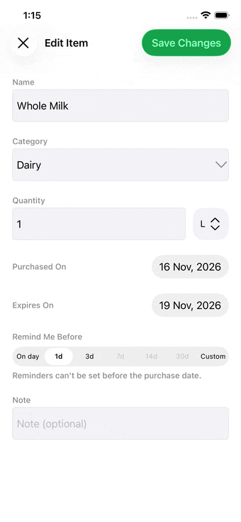
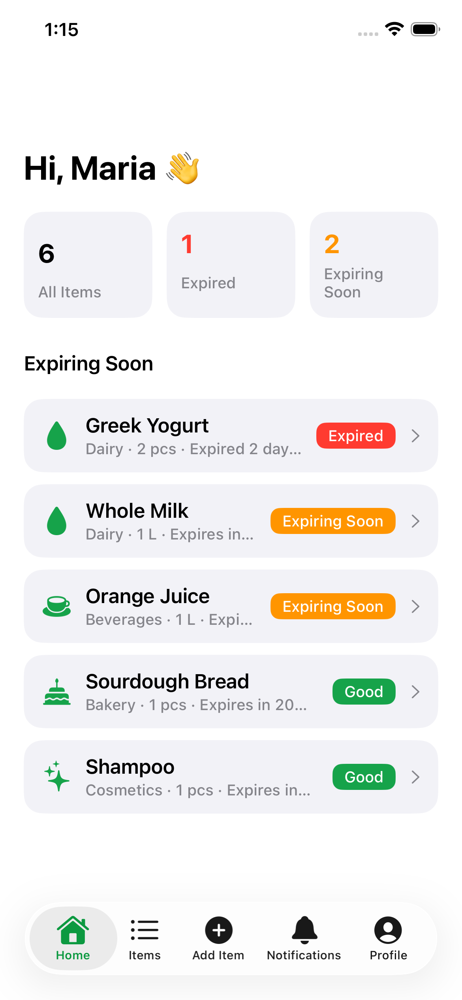
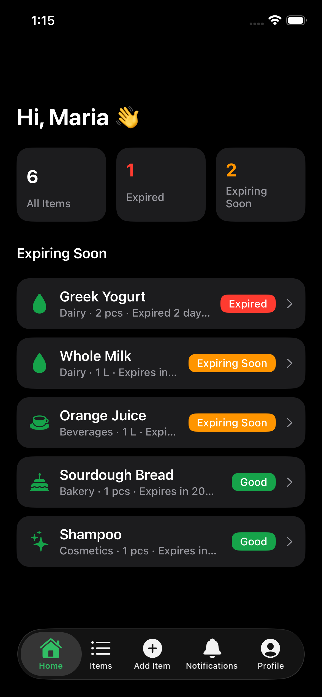
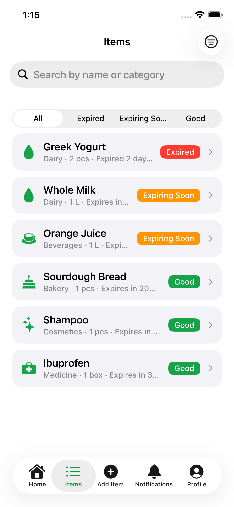
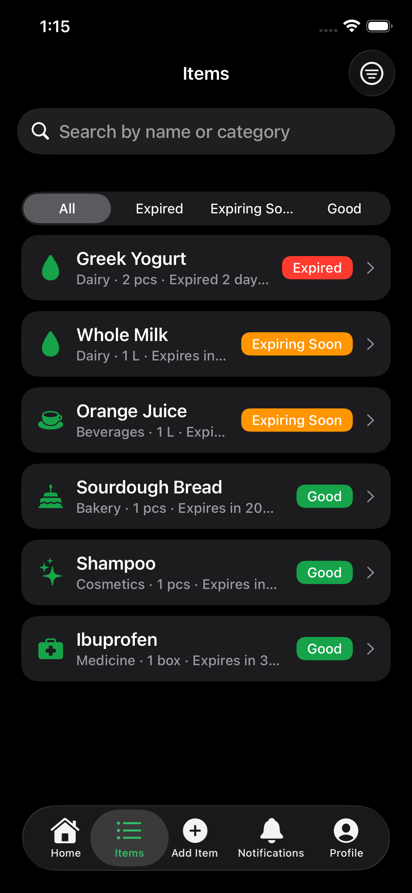
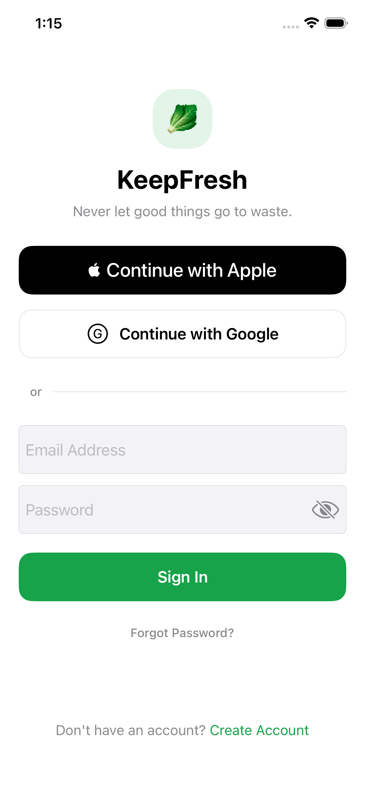
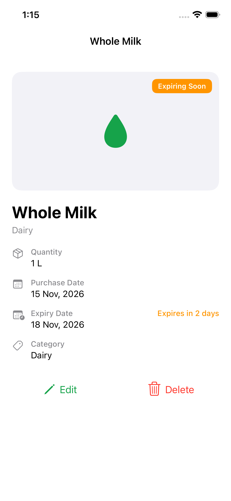
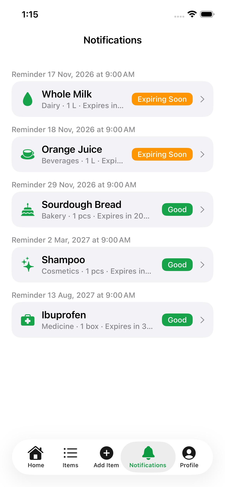
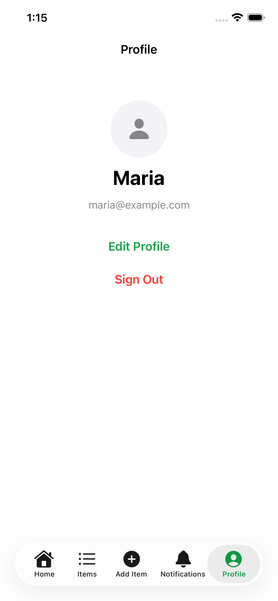

# KeepFresh

**An iOS app that tracks the shelf life of packaged products and reminds you before they expire.**

Built end-to-end in Swift/UIKit with a real Firebase authentication backend, local-first persistence via SwiftData, and scheduled local notifications — architected around MVVM-C for testability and a clean separation between UI, business logic, and data.


-blue)


---

## Overview

KeepFresh solves a simple, everyday problem: packaged food and household products get pushed to the back of a cupboard and forgotten until they've expired. The app lets a user log what they own — name, category, quantity, purchase date, expiry date — and get a local notification before each item goes bad, with a traffic-light status system (Good / Expiring Soon / Expired) driving the UI throughout.

The project is built as a portfolio-quality reference for iOS engineering practices: no storyboards, no third-party UI kits, a protocol-first service layer that swaps real implementations in behind mocks, and a growing suite of unit tests around the pieces that carry real logic (expiry-status math, repository contracts, form validation).

## Demo

<p align="center">
  
</p>

## Screenshots

> Captured deterministically from seeded in-memory fakes via `scripts/capture-screenshots.sh` — no manual setup, reproducible on any machine.

**Light & Dark Mode** — the whole UI is built on dynamic system colors, so Dark Mode comes for free:

<table>
  <tr>
    <td align="center"><sub><b>Home · Light</b></sub><br></td>
    <td align="center"><sub><b>Home · Dark</b></sub><br></td>
    <td align="center"><sub><b>Items · Light</b></sub><br></td>
    <td align="center"><sub><b>Items · Dark</b></sub><br></td>
  </tr>
</table>

**Key screens:**

<table>
  <tr>
    <td align="center"><sub><b>Sign In</b></sub><br></td>
    <td align="center"><sub><b>Add / Edit Item</b></sub><br></td>
    <td align="center"><sub><b>Item Details</b></sub><br></td>
    <td align="center"><sub><b>Notifications</b></sub><br></td>
    <td align="center"><sub><b>Profile</b></sub><br></td>
  </tr>
</table>

<sub>The Add / Edit screen above shows the <b>reminder-window validation</b> in action — lead-time options that would fire before the purchase date are disabled, with an inline explanation.</sub>

## Features

- **Authentication** — Sign in with Apple, Google Sign-In, and email/password, all backed by Firebase Auth (`AuthServiceProtocol`, with `FirebaseAuthService` as the production conformer and `MockAuthService` kept for previews/tests). Sessions persist across launches; signing out requires confirmation.
- **Item tracking** — Add and edit items with name, category, quantity + unit (a closed set, not free text), purchase date, expiry date, an optional note, and a configurable reminder lead time (presets plus a free-form "Custom" value).
- **Smart reminder window** — reminder lead-time options that would schedule a notification *before* the item was purchased are automatically disabled, with an inline explanation; an out-of-range custom value is rejected with a clear message — so every reminder that's saved is guaranteed to actually fire.
- **Home dashboard** — A greeting header, three summary cards (All Items / Expired / Expiring Soon), and a live "Expiring Soon" preview of the five soonest-expiring items.
- **Items list** — Full inventory with search, a status-filter segmented control, and a category filter + sort menu.
- **Item details** — Full detail view per item, with edit and delete (delete also cancels that item's scheduled notification).
- **Local notifications** — Expiry reminders scheduled via `UNUserNotificationCenter`, with deterministic identifiers so rescheduling never leaks duplicates; the Notifications tab lists everything currently scheduled.
- **Profile** — Edit display name (changes propagate live to the Home greeting), sign out (with confirmation).
- **Accessibility & Dark Mode** — Dynamic Type throughout (fonts routed through `UIFontMetrics`), VoiceOver labels on primary controls, and full Dark Mode via dynamic system colors — no hardcoded palette.

## Engineering highlights

The parts a reviewer is most likely to care about:

- **Protocol-first dependency injection, no singletons.** Three cross-cutting seams — `AuthServiceProtocol`, `ItemRepository`, `NotificationServiceProtocol` — are each injected via initializer, with a production implementation *and* an in-memory fake. The entire app runs, and is tested, with zero network or disk.
- **MVVM-C with UIKit-free ViewModels.** Coordinators own all navigation; ViewModels hold presentation logic and import no UIKit, so they're unit-tested in isolation (e.g. `ItemEditorViewModel`'s validation and reminder-window math).
- **Single source of truth for domain rules.** Expiry status (Good / Expiring Soon / Expired) lives only in a pure `ExpiryStatusCalculator` that takes an injected `Date`/`Calendar`/`TimeZone` — no date logic duplicated in views, and DST/boundary cases are covered by tests.
- **Deterministic local notifications.** Reminder identifiers are derived (`expiry.<uuid>.<date>`) so an edit or delete always cancels/replaces the exact right pending request — rescheduling never leaks duplicates.
- **Considered UIKit control work.** The reminder picker is a small `UISegmentedControl` subclass (`ReselectableSegmentedControl`) that reports re-taps on the already-selected segment — the stock control swallows them — to drive a custom-value editor, alongside purchase-date-aware option disabling.
- **Reproducible, seeded screenshots.** A launch-flag screenshot mode renders any screen against seeded fakes, and `scripts/capture-screenshots.sh` drives the simulator to capture the light/dark grid above — the same media that ships in this README.
- **40+ unit tests** across expiry-status logic, the repository contract, and item-editor validation.

## Tech stack

| Layer | Choice |
|---|---|
| Language | Swift 5.9 |
| UI | UIKit, 100% programmatic (no Storyboards/XIBs) |
| Architecture | MVVM-C (Model–View–ViewModel–Coordinator — ViewModels hold presentation logic and are unit-testable in isolation; Coordinators own navigation so view controllers don't push/present each other directly) |
| Persistence | SwiftData (local-only for v1) |
| Auth | Firebase Auth + GoogleSignIn-iOS SDK (Apple / Google / email-password) |
| Notifications | `UserNotifications` (local, on-device scheduling) |
| Testing | XCTest — 40+ unit tests across expiry-status logic, the repository contract, and item-editor validation |
| Minimum target | iOS 17.0 |

## Architecture notes

Every cross-cutting concern is defined as a protocol and injected, not reached for as a singleton:

- `AuthServiceProtocol` → `FirebaseAuthService` (production) / `MockAuthService` (tests, previews)
- `ItemRepository` → `SwiftDataItemRepository` (production) / `InMemoryItemRepository` (tests)
- `NotificationServiceProtocol` → `LocalNotificationService` (production) / `InMemoryNotificationService` (tests)

This keeps the ViewModel and view-controller layers free of Firebase/SwiftData imports, and means the whole app can run — and be tested — against fakes with zero network or disk dependency.

## Project structure

```
KeepFresh/
  App/          AppDelegate, SceneDelegate, AppCoordinator, AppTheme
  Features/     Auth, Home, Items, AddItem, ItemEditor, ItemDetails, Notifications, Profile
  Models/       Item, ExpiryStatus, ExpiryStatusCalculator, CategoryIcon
  Services/     Auth, persistence, and notification protocols + implementations
  Shared/       Reusable views (PrimaryButton, ItemRowView, EmptyStateView, ...)
  Resources/    Assets.xcassets
KeepFreshTests/ Unit tests
```

## Getting started

1. Clone the repo and open `KeepFresh.xcodeproj` in Xcode 15+.
2. **Signing** — In *Signing & Capabilities*, select your own development team (automatic signing is already configured; bundle ID is `com.maria.keepfresh`).
3. **Sign in with Apple** — Enable the *Sign in with Apple* capability on your App ID in the Apple Developer portal; the entitlement is already requested in `KeepFresh.entitlements`, but Xcode can't provision it until it's enabled on the App ID.
4. **Firebase** — Add your own `GoogleService-Info.plist` to the project root (this file is gitignored on purpose — never commit real Firebase credentials).
5. Build and run on an iOS 17+ simulator or device.

## Running tests

```
Cmd+U in Xcode
```
or
```
xcodebuild test -project KeepFresh.xcodeproj -scheme KeepFresh -destination 'platform=iOS Simulator,name=iPhone 15'
```

## Roadmap

- Account deletion (local data + Firebase user)
- Persisted notification history (read/unread, clear history)
- Optional Firestore/Storage sync for multi-device support
- TestFlight release

## Author

Built by [Maria Sultana](https://github.com/MariaSultana20).
